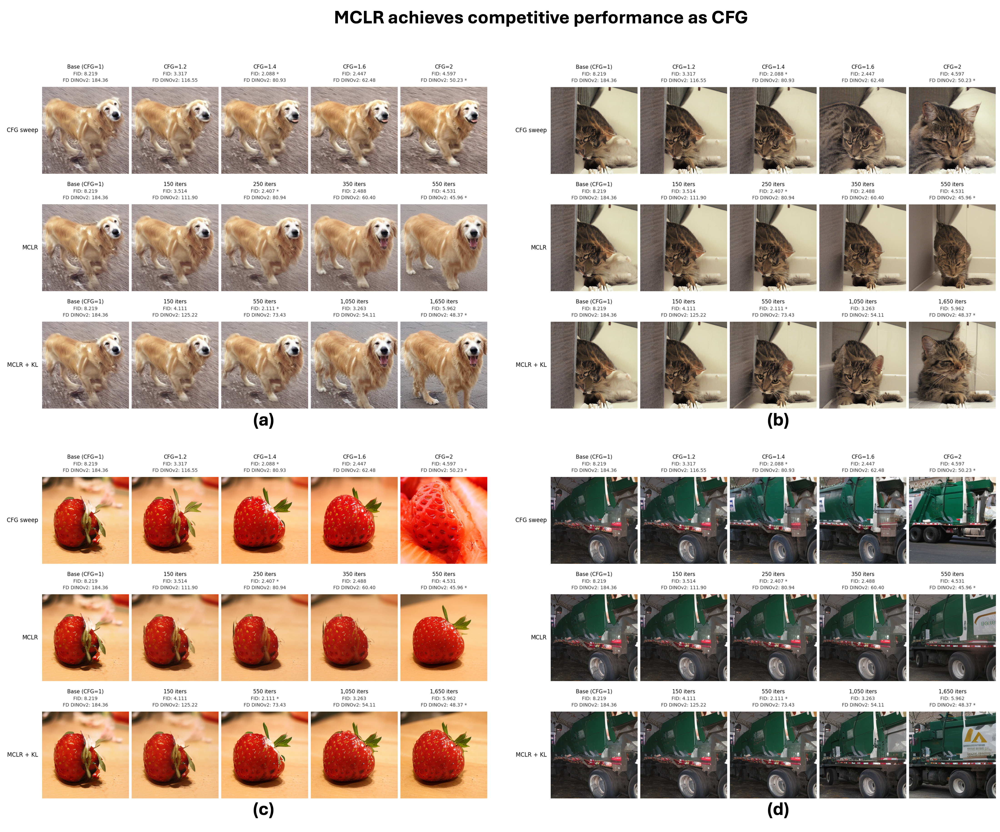

## MCLR: Improving Conditional Modeling via Inter-Class Likelihood-Ratio Maximization and Unifying Classifier-Free Guidance with Alignment Objectives<br><sub>Official PyTorch implementation of the NeurIPS 2026 paper</sub>

Xiang Li, Yixuan Jia, Xiao Li, Jeffrey A. Fessler,  Rongrong Wang, Qing Qu
<br>[https://arxiv.org/abs/2603.22364](https://arxiv.org/abs/2603.22364)<br>
Abstract: *Diffusion models achieve strong generative performance but often rely on classifier-free guidance
(CFG), an inference-time intervention that modifies the sampling trajectory. Since standard denoising
score matching (DSM) should recover the target distribution when the score is learned accurately, the
practical necessity of CFG suggests deficiencies in learned conditional scores. We identify weak inter-class separation as one such limitation: samples generated from the same noise under different labels
can retain similar class-agnostic structure. To address this deficiency, we introduce MCLR, a principled
fine-tuning objective that explicitly maximizes inter-class likelihood-ratios, thereby strengthening classspecific structures under standard sampling. Across diverse models and datasets, MCLR substantially
improves guidance-free conditional generation and narrows the gap to CFG. Theoretically, we prove that
the CFG-guided score is the unique minimizer of a sample-adaptively weighted, ELBO-approximated
MCLR objective, interpreting CFG as an implicit inference-time contrastive alignment procedure. We
further compare MCLR with related contrastive objectives, including DPO, CCA, and CFM, clarifying
their connections and key differences in an otherwise fragmented literature.*



## 1. Preparing the Environment and Training Datasets
To set up the environment and prepare training datasets, please refer to [preprocessing guide](preprocessing/README.md).

## 2. Sampling with Pretrained Models
Our pretrained MCLR checkpoints are available on [Hugging Face](https://huggingface.co/SeanLi0210/MCLR-SiT-XL-2-REPA/blob/main/weights).

Please download the checkpoints and place them in the `weights/` directory.

[MCLR_Weights_Demo.ipynb](MCLR_Weights_Demo.ipynb) provides a simple example of loading these checkpoints and comparing MCLR fine-tuning with classifier-free guidance (CFG). Each comparison uses the same initial noise and class labels to visualize changes across CFG scales or fine-tuning iterations.

## 3. Training New Models

In this work we focus on fine-tuning the pretrained SiT-XL/2 model released by [SiT+REPA](https://github.com/sihyun-yu/REPA). Please download their checkpoint (last.pt) and place it at `pretrained_models/last.pt`. Alternatively, download our copy from [Hugging Face](https://huggingface.co/SeanLi0210/MCLR-SiT-XL-2-REPA/blob/main/weights/base_repa.pt), rename it as last.pt, and place it in the same directory. 

Using 50-step Euler ODE sampling and 50,000 generated images, the base model achieves an FID of 8.22 and an FD<sub>DINOv2</sub> of 184.36 without classifier-free guidance (CFG scale = 1.0). Among the evaluated CFG scales, its best FID is 2.09 at CFG scale 1.4, and its best FD<sub>DINOv2</sub> is 50.23 at CFG scale 2.0.

Although the base model was pretrained with REPA, our fine-tuning does not use representation alignment (--enc-type="None").

All fine-tuning results below use 50-step Euler ODE sampling, CFG scale = 1.0, and 50,000 generated images. We evaluate the model weights in each checkpoint. Reported optima are the best observed values among the evaluated checkpoints. Iterations refer to fine-tuning optimizer steps. 

We note that all the results in our paper are evaluated on the running model, instead of their EMA version. Models obtained via EMA could potentially achieve even better performance.

### 1) Fine-tune with MCLR without DSM or KL Terms

Here we directly fine-tune with MCLR objective alone, without additional DSM or KL terms. This setting reaches a best-case FID 2.41 at iteration 250 and a best-case FD<sub>DINOv2</sub> 45.96 at iteration 550. The command below stops training at 600 iterations and saves checkpoints every 50 iterations, retaining both checkpoints. The final checkpoint is not necessarily the best checkpoint.
 
```
accelerate launch --num_processes 1 MCLR_finetuning.py --report-to="wandb" \
  --allow-tf32 \
  --mixed-precision="fp16" \
  --seed=0 \
  --path-type="linear" \
  --prediction="v" \
  --weighting="uniform" \
  --model="SiT-XL/2" \
  --encoder-depth=8 \
  --enc-type="None" \
  --output-dir="exps_MCLR" \
  --exp-name="mclr_finetuning_repa_ema_0.9999_lr_1e-6" \
  --data-dir="data" \
  --batch-size=64 \
  --max-train-steps=600 \
  --checkpointing-steps=50 \
  --sampling-steps=50 \
  --learning-rate=1e-6 \
  --ema-weight-decay=0.9999 \
  --initial-weight="pretrained_models/last.pt" \
  --loss-type="MCLR" 
```

### 2) Fine-tune with MCLR with DSM Term

Here we fine-tune with both MCLR regularization and the standard diffusion loss (DSM). More details can be found in Appendix G.1 of our paper. This setting reaches a best-case FID 2.25 at iteration 850 and a best-case FD<sub>DINOv2</sub> 52.63 at iteration 2050.

```
accelerate launch --num_processes 1 MCLR_finetuning.py --report-to="wandb" \
  --allow-tf32 \
  --mixed-precision="fp16" \
  --seed=0 \
  --path-type="linear" \
  --prediction="v" \
  --weighting="uniform" \
  --model="SiT-XL/2" \
  --encoder-depth=8 \
  --enc-type="None" \
  --output-dir="exps_MCLR" \
  --exp-name="mclr_finetuning_dsm_reg1_ema_0.9999_lr_1e-6" \
  --data-dir="data" \
  --batch-size=64 \
  --max-train-steps=2500 \
  --checkpointing-steps=50 \
  --sampling-steps=50 \
  --learning-rate=1e-6 \
  --ema-weight-decay=0.9999 \
  --initial-weight="pretrained_models/last.pt" \
  --loss-type="MCLR" \
  --use-dsm \
  --dsm-reg=1
```

### 3) Fine-tune with MCLR with KL Term
Here we fine-tune with both MCLR regularization and the KL loss. More details can be found in Appendix G.1 of our paper. This setting reaches a best-case FID 2.11 at iteration 550 and a best-case FD<sub>DINOv2</sub> 48.37 at iteration 1650.
```
accelerate launch --num_processes 1 MCLR_finetuning.py --report-to="wandb" \
  --allow-tf32 \
  --mixed-precision="fp16" \
  --seed=0 \
  --path-type="linear" \
  --prediction="v" \
  --weighting="uniform" \
  --model="SiT-XL/2" \
  --encoder-depth=8 \
  --enc-type="None" \
  --output-dir="exps_MCLR" \
  --exp-name="mclr_finetuning_trust_region_reg1_ema_0.9999_lr_1e-6" \
  --data-dir="data" \
  --batch-size=64 \
  --max-train-steps=2000 \
  --checkpointing-steps=50 \
  --sampling-steps=50 \
  --learning-rate=1e-6 \
  --ema-weight-decay=0.9999 \
  --initial-weight="pretrained_models/last.pt" \
  --loss-type="MCLR" \
  --use-trust-region \
  --trust-region-reg=1
```

### 4) Alternative Contrastive Objectives
We also provide commands for alternative contrastive objectives, including CC-DPO, CCA, and CFM in [run.sh](run.sh).


## 4. Model Evaluation

### Generate images for evaluation

Generate 50,000 images from a fine-tuned checkpoint using 50-step Euler ODE sampling without CFG (CFG scale = 1.0). The command below uses four GPUs and evaluates the checkpoint's model weights.

```
torchrun --standalone --nnodes=1 --nproc_per_node=4 generate.py \
  --ckpt="mclr_weights/mclr_fid_best_0000250.pt" \
  --sample-dir="samples" \
  --model="SiT-XL/2" \
  --resolution=256 \
  --encoder-depth=8 \
  --projector-embed-dims=768 \
  --num-fid-samples=50000 \
  --per-proc-batch-size=50 \
  --path-type="linear" \
  --mode="ode" \
  --num-steps=50 \
  --no-heun \
  --cfg-scale=1.0 \
  --guidance-low=0.0 \
  --guidance-high=1.0 \
  --global-seed=0 \
  --vae="ema"
```

### 1) Calculate FID and FD_DinoV2
To calculate FID and FD_DinoV2 scores, we first need to compute the reference statistics. Here we use 256×256 as an example. The same procedure applies to other resolutions.

```
# Convert raw ImageNet data to a ZIP archive at 256x256 resolution
cd edm2
python dataset_tool.py convert --source=downloads/imagenet/ILSVRC/Data/CLS-LOC/train \
    --dest=datasets/img256.zip --resolution=256x256 --transform=center-crop-dhariwal 
```

Next, compute reference statistics:

```
python calculate_metrics.py ref --data=datasets/img256.zip --dest=fd-refs/img_256.pkl 
```

Our precomputed reference statistics can be found [here](https://huggingface.co/SeanLi0210/MCLR-SiT-XL-2-REPA/tree/main/ref_statistics/fd_refs).

Now let's compute the FID and FD_DinoV2 scores by running the following code, where "out" is the folder in which you store 50,000 generated images.:

```
torchrun --nproc_per_node=4 calculate_metrics.py calc --images=out \
          --save_path=FD_scores --num=50000 --ref=fd-refs/img_256.pkl 
```

### 2) Compute Precision and Recall

Both Precision and Recall can be computed on both DinoV2 and Inception features, hence we need to prepare reference statistics for both.
To do so, we first need to sample 50,000 images from the training dataset. Since ImageNet has 1000 calss, we need to sample 50 samples from each class:

```
# Convert raw ImageNet data to a ZIP archive at 256x256 resolution, randomly selecting 50 samples for each of the 1000 class. The final dataset will have 50,000 images in total.
cd edm2
python dataset_tool_50k.py convert --source=downloads/imagenet/ILSVRC/Data/CLS-LOC/train \
    --dest=datasets/img256_50k.zip --resolution=256x256 --transform=center-crop-dhariwal 
```

```
# Prepare features for calculating precision and recall.
torchrun --nproc_per_node=1 calculate_metrics.py calc-features  --images=datasets/img256_50k.zip \
                                                                 --save_path=feature_embeddings_ImageNet/img256_50k
```

Our precomputed reference statistics can be found [here](https://huggingface.co/SeanLi0210/MCLR-SiT-XL-2-REPA/tree/main/ref_statistics/feature_embeddings_ImageNet_256/50k).

Now, let's compute the Precision and Recall:

```
torchrun --nproc_per_node=4 calculate_metrics.py calc-precision-recall --images=out \
         --save_path=Precision_and_recall/ --ref_feature_path=feature_embeddings_ImageNet/img256_50k
```

### 3) Compute Inception Score

Computing Inception score is easier, since we don't need to prepare reference statistics in advance. All we need is a collection of 50,000 generated images stored in folder '"out":

```
torchrun --nproc_per_node=4 calculate_metrics.py calc-inception  --images=out --save_path=Inception_score/

```

## 5. MCLR for EDM2
Please see [here](https://github.com/Morefre/MCLR-Contrastive-Alignment-for-Improving-Conditional-Modeling/tree/MCLR-for-EDM2) for the implementation of MCLR with EDM2.

## References
Our implementation is based on [REPA](https://github.com/sihyun-yu/REPA?tab=readme-ov-file) and [EDM2](https://github.com/NVlabs/edm2).

## Citation
If you find our work interesting, please consider citing
```
@article{li2026mclr,
  title={MCLR: Improving Conditional Modeling via Inter-Class Likelihood-Ratio Maximization and Unifying Classifier-Free Guidance with Alignment Objectives},
  author={Li, Xiang and Jia, Yixuan and Li, Xiao and Fessler, Jeffrey A and Wang, Rongrong and Qu, Qing},
  journal={arXiv preprint arXiv:2603.22364},
  year={2026}
}
```
